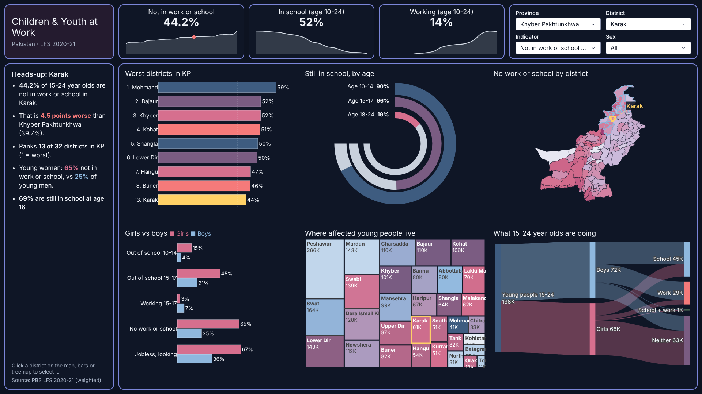
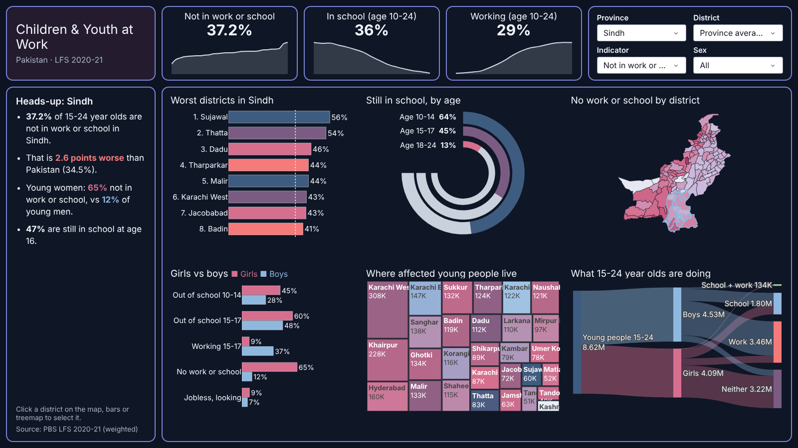

# Children & Youth at Work: Pakistan district dashboard

An interactive, one-screen dashboard of school, work and youth inactivity across **131 districts of Pakistan**, built from the **PBS Labour Force Survey 2020-21** microdata (the first LFS round representative at district level).



## What it shows

Pick a province, a district (or the province average), sex and an indicator. Click any district on the map, the bar chart or the treemap to switch to it.

| Panel | Question it answers |
|---|---|
| Heads-up | Plain-English summary of the selected area |
| KPI tiles | Headline value; share in school and working by age (sparklines) |
| Worst districts | Which districts in the province have the highest need |
| Still in school, by age | Share in school at ages 10-14, 15-17 and 18-24 |
| District map | Where the indicator is highest |
| Girls vs boys | Gender gaps on the main indicators |
| Where affected young people live | Treemap sized by estimated number of people affected |
| What 15-24 year olds are doing | Flow: young people → girls/boys → school / work / both / neither |

### Indicators

| Indicator | Population | SDG link |
|---|---|---|
| Out of school | Age 10-14; age 15-17 | 4.1 |
| Children / teens working (any work in reference week) | Age 10-14; 15-17 | 8.7 |
| Working and not in school | Age 10-17 | 8.7 |
| Not in employment or education | Age 15-24 | 8.6.1 |
| Youth unemployment rate (ILO definition) | Labour force 15-24 | 8.5.2 |
| Female labour force participation | Women 15-64 | 8.5 |
| Girls-minus-boys gaps (not in work/school; out of school) | 15-24; 10-14 | 5 / 4.5 |



## Method

- Estimates are weighted with LFS expansion weights.
- 95% confidence intervals are design-based: linearised standard errors with enumeration blocks as PSUs and districts as strata.
- Estimates with fewer than 50 sample observations are suppressed; fewer than 100, or a CI half-width above 10 points, are flagged "use with caution".
- Age profiles use a 3-year moving window to stabilise district-level cells.
- 2022 district boundaries are mapped back to the 2020-21 districts (Chitral and Kohistan re-merged; Chaman → Killa Abdullah; Lehri → Sibi). See `data/shape_crosswalk.csv`.
- The 15-24 flow diagram derives group sizes from the NEET count and rate, then splits them by status shares; treat its counts as estimates.

**Caveats.** "Working children" is any employment in the reference week; LFS does not record household chores or hazardous work, so this is not the full SDG 8.7.1 child-labour measure. "Not in employment or education" does not count training. Chagai's out-of-school rate (2.4%, age 10-14) is implausibly low and should be checked against ASER/PSLM.

## Run it

```bash
pip install -r requirements.txt
python app.py            # then open http://127.0.0.1:8050 and press F11
```

From Jupyter: `%run app.py` (opens in a new browser tab).

## Rebuild the data

The aggregated tables in `data/` are included. To regenerate them from the PBS microdata (not included in this repository; available from the Pakistan Bureau of Statistics):

```bash
pip install pyreadstat
python prep/lfs_dashboard_prep.py path/to/LFS2020-21.dta data
```

## Structure

```
app.py                     Dash dashboard
prep/lfs_dashboard_prep.py microdata → weighted indicators, CIs, reliability flags, percentiles, age profiles
data/                      aggregated CSVs + districts.topojson (district boundaries)
docs/                      screenshots
```

## Author

Danyal Khattak. Data: Pakistan Bureau of Statistics, Labour Force Survey 2020-21.
